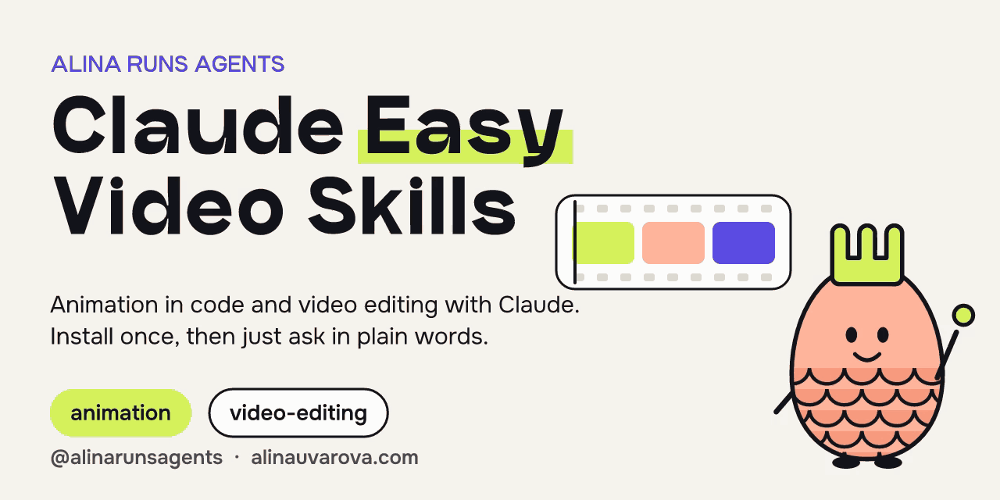
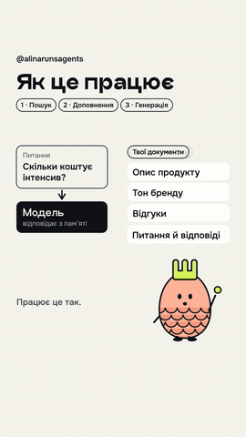
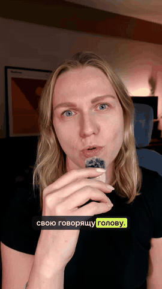

<p align="center">
  
</p>

<p align="center">
  <b>English</b> · <a href="README.uk.md">Українською</a>
</p>

<p align="center">
  <a href="https://t.me/alinarunsagents">Telegram</a> ·
  <a href="https://www.instagram.com/alinarunsagents">Instagram</a> ·
  <a href="https://www.threads.net/@alina.runs.agents">Threads</a> ·
  <a href="https://alinauvarova.com">alinauvarova.com</a>
</p>

# Claude Easy Video Skills

Two free skills for Claude Code from **[Alina Runs Agents](https://alinauvarova.com)**. Install them once, and Claude knows how to animate and how to edit video. You just ask in plain words.

- **animation**: animated videos made in code. Explainers, step-by-step how-tos, motion covers, small cartoons. Code draws every frame, FFmpeg joins the frames into a video. No After Effects, no AI video generation.
- **video-editing**: editing your footage. Cuts pauses and filler words, slices a long stream into reels, reframes to 9:16 / 4:5 / 1:1 / 16:9, adds captions with word highlighting, music and even loudness. Runs on your computer (FFmpeg + Whisper), no paid services.

## What you get

Made with these skills: an explainer, a how-to «Instruction» reel, and a talking-head reel edited with highlighted captions.

<table>
<tr>
<td align="center" width="33%"><br><sub><b>Explainer</b><br>diagram builds step by step</sub></td>
<td align="center" width="33%"><br><sub><b>How-to reel</b><br>numbered steps, mascot, UI mockups</sub></td>
<td align="center" width="33%"><br><sub><b>Edited reel</b><br>pauses cut, captions with word highlight</sub></td>
</tr>
</table>

Typical result: a 30–60 second 9:16 reel with captions and voice, from a script you write in plain words. Ask for 4:5 or 16:9 and you get the same video in those formats.

## Quick start

In the Claude Code message box, run:

```
/plugin marketplace add uvallie/claude-easy-video-skills
```

```
/plugin install easy-video-skills@alina-runs-agents
```

Restart the session, open an empty folder and write: «Let's make an animation» or «Help me edit a video». Claude starts the onboarding.

## First run: onboarding

The first time each skill runs, Claude:

1. checks what is already installed and offers to install what is missing (it asks before every step);
2. helps you find your style from references: get inspired, don't copy;
3. if you want, connects a key for voice (Gemini is free and tested; ElevenLabs and OpenAI are supported but not tested yet) or for image models. The key stays in a `.env` file on your computer, you never paste it into the chat;
4. saves everything in the project settings, so next time it doesn't ask again.

Then just ask: «make an animation from this script», «cut three reels with captions from this stream», «make the hook bigger».

## What you need

- The Claude desktop app (claude.ai/download), **Code** tab, or Claude Code in a terminal. A paid Claude plan.
- Mac (tested). Linux and Windows via WSL should work but are not tested yet: the scripts are bash. Claude installs Node.js, FFmpeg and Python itself once you agree.

## Install

### Option 1. As a plugin (recommended)

Run the two commands from [Quick start](#quick-start). The skills trigger on their own when you ask for animation or editing. You can also call them directly: `/easy-video-skills:animation`, `/easy-video-skills:video-editing`.

In the Claude app you can also add plugins with **+** next to the message box → **Add plugins**. If the marketplace isn't listed, run the first command above once.

### Option 2. Copy by hand

Download the repo (Code → Download ZIP) and copy `plugins/easy-video-skills/skills/animation` and `plugins/easy-video-skills/skills/video-editing` into `~/.claude/skills/`. On Windows that's `C:\Users\<name>\.claude\skills\`. Start a new session.

## Where to start

1. Create an empty folder, for example «Animation» or «Video editing».
2. In Claude Code, open that folder: the laptop button under the message box → **New environment** → **Folders: Add**.
3. Write: «Let's make an animation» or «Help me edit a video». Claude starts the onboarding.

## What's inside

```
plugins/easy-video-skills/skills/
├── animation/
│   ├── SKILL.md            workflow: onboarding → script → style → storyboard → video → voice → edits
│   ├── engine/             engine: frame(t) → SVG → resvg → FFmpeg; motion, text, voice, synthesized music
│   ├── references/         animation rules, choosing a voice, image models
│   └── scripts/check.sh    checks what is missing
└── video-editing/
    ├── SKILL.md            workflow: onboarding → transcription → cut → reframe → captions → loudness
    ├── scripts/            transcribe, keeps (cut pauses), cut_edl, reframe, burn_captions, loudnorm, synth_bed…
    ├── config/             formats and caption style
    └── references/         formats, safe zones, caption settings
```

The skills talk to you in your language. The instructions inside them are in Ukrainian.

## Safety

- Keys live only in the `.env` file in your folder. The skills never ask you to paste a key into the chat and never show it.
- Claude installs or publishes nothing without your «yes».
- References are for inspiration. We don't copy other people's characters, logos or content.

## Made by

**Alina Uvarova** · [Alina Runs Agents](https://alinauvarova.com). I show how to hand real work to AI agents: video, content, marketing. The mascot on the banner is ШІшка.

Follow along: [Telegram](https://t.me/alinarunsagents) · [Instagram](https://www.instagram.com/alinarunsagents) · [Threads](https://www.threads.net/@alina.runs.agents)

If the skills helped you, put a ⭐ on the repo, it helps other people find them.

MIT license: use, change and share freely.
