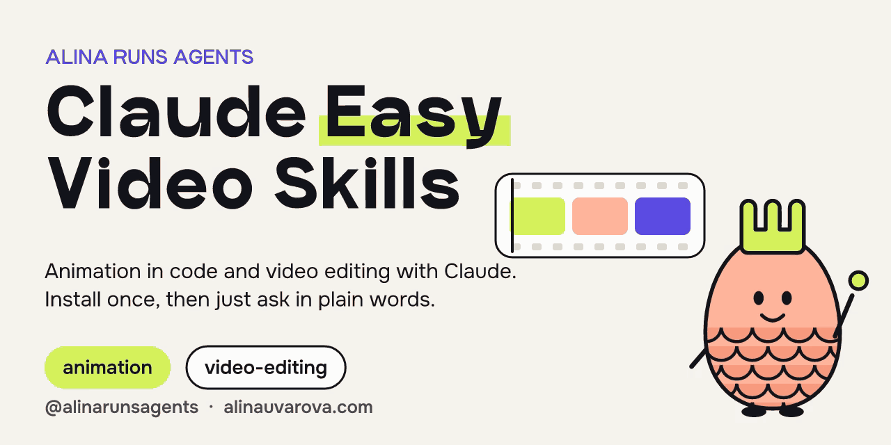
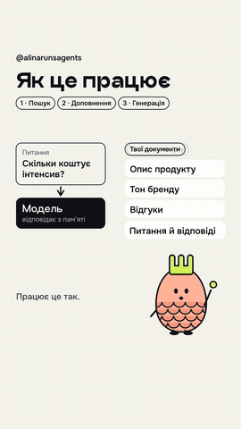
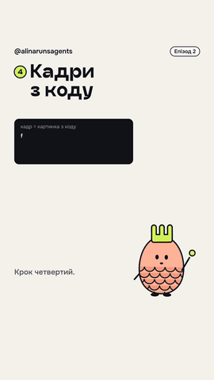
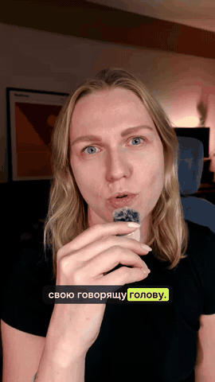

<p align="center">
  
</p>

<p align="center">
  <a href="README.md">English</a> · <b>Українською</b>
</p>

<p align="center">
  <a href="https://t.me/alinarunsagents">Telegram</a> ·
  <a href="https://www.instagram.com/alinarunsagents">Instagram</a> ·
  <a href="https://www.threads.net/@alina.runs.agents">Threads</a> ·
  <a href="https://alinauvarova.com">alinauvarova.com</a>
</p>

# Claude Easy Video Skills

Два безкоштовні скіли для Claude Code від **[Alina Runs Agents](https://alinauvarova.com)**. Ставиш один раз, і далі Claude сам знає, як робити анімацію і як монтувати відео.

- **animation**: анімовані відео кодом. Explainer-ролики, покрокові інструкції, анімовані обкладинки, міні-мультики. Кожен кадр малює код, FFmpeg склеює кадри у відео. After Effects і ШІ-генерація відео не потрібні.
- **video-editing**: монтаж. Вирізає паузи, нарізає довгі ефіри на рілзи, перекадровує під 9:16 / 4:5 / 1:1 / 16:9, додає субтитри з підсвіткою слів, музику й рівну гучність. Працює на твоєму комп'ютері (FFmpeg + Whisper), без платних сервісів.

## Що виходить

Зроблено цими скілами: explainer, рілз-«Інструкція» і змонтований рілз із підсвіткою слів у субтитрах.

<table>
<tr>
<td align="center" width="33%"><br><sub><b>Explainer</b><br>схема будується крок за кроком</sub></td>
<td align="center" width="33%"><br><sub><b>Інструкція</b><br>кроки, маскот, макети вікон</sub></td>
<td align="center" width="33%"><br><sub><b>Монтаж</b><br>без пауз, субтитри з підсвіткою слів</sub></td>
</tr>
</table>

Перший запуск кожного скіла — знайомство. Claude:

1. перевіряє, що вже встановлено, і пропонує поставити відсутнє (питає перед кожним кроком);
2. допомагає знайти твій стиль за референсами: «надихайся, але не копіюй»;
3. за бажанням підключає ключ для голосу (Gemini — безкоштовний і перевірений; ElevenLabs і OpenAI підтримуються, але ще не перевірені) або моделі для картинок. Ключ лежить у файлі `.env` на твоєму комп'ютері, у чат його вставляти не треба;
4. записує все в налаштування проєкту, тож наступного разу питати не буде.

Далі достатньо написати звичайними словами: «зроби анімацію за цим сценарієм», «наріж із цього ефіру три рілзи з субтитрами», «зроби хук більшим».

## Що потрібно

- Застосунок Claude на комп'ютері (claude.ai/download), вкладка **Code**, або Claude Code у терміналі. Потрібна платна підписка Claude.
- Mac (перевірено). Linux і Windows через WSL мають працювати, але ще не перевірені: скрипти написані для bash. Node.js, FFmpeg і Python Claude поставить сам, коли ти погодишся.

## Як встановити

### Варіант 1. Через плагін (рекомендовано)

У полі повідомлення Claude Code напиши по черзі:

```
/plugin marketplace add uvallie/claude-easy-video-skills
```

```
/plugin install easy-video-skills@alina-runs-agents
```

Перезапусти сесію. Скіли спрацьовують самі, коли просиш про анімацію чи монтаж. Можна викликати й напряму: `/easy-video-skills:animation`, `/easy-video-skills:video-editing`.

У застосунку Claude плагіни також можна додати через **+** біля поля повідомлення → **Add plugins**. Якщо маркетплейсу немає в списку, один раз виконай першу команду вище.

### Варіант 2. Скопіювати вручну

Завантаж репозиторій (Code → Download ZIP) і скопіюй папки `plugins/easy-video-skills/skills/animation` та `plugins/easy-video-skills/skills/video-editing` у `~/.claude/skills/`. На Windows це `C:\Users\<ім'я>\.claude\skills\`. Почни нову сесію.

## З чого почати

1. Створи порожню папку, наприклад «Анімація» або «Відеомонтаж».
2. У Claude Code відкрий цю папку: кнопка з ноутбуком під полем повідомлення → **New environment** → **Folders: Add**.
3. Напиши: «Давай зробимо анімацію» або «Допоможи змонтувати відео». Claude почне знайомство.

## Що всередині

```
plugins/easy-video-skills/skills/
├── animation/
│   ├── SKILL.md            порядок роботи: знайомство → сценарій → стиль → розкадровка → відео → голос → правки
│   ├── engine/             рушій: frame(t) → SVG → resvg → FFmpeg; рух, текст, голос, синтезована музика
│   ├── references/         правила анімації, вибір голосу, моделі для картинок
│   └── scripts/check.sh    перевірка, чого бракує
└── video-editing/
    ├── SKILL.md            порядок роботи: знайомство → транскрипція → монтаж → кадрування → субтитри → гучність
    ├── scripts/            transcribe, keeps (вирізати паузи), cut_edl, reframe, burn_captions, loudnorm, synth_bed…
    ├── config/             формати й стиль субтитрів
    └── references/         формати, безпечні зони, налаштування субтитрів
```

## Безпека

- Ключі зберігаються лише у файлі `.env` у твоїй папці. Скіли не просять вставляти ключ у чат і не показують його.
- Claude нічого не встановлює й не публікує без твого «так».
- Референси потрібні для натхнення. Чужих персонажів, логотипи й контент не копіюємо.

## Хто зробив

**Аліна Уварова** · [Alina Runs Agents](https://alinauvarova.com). Показую, як віддавати реальну роботу ШІ-агентам: відео, контент, маркетинг. Маскот на банері — ШІшка.

Слідкуй: [Telegram](https://t.me/alinarunsagents) · [Instagram](https://www.instagram.com/alinarunsagents) · [Threads](https://www.threads.net/@alina.runs.agents)

Якщо скіли допомогли, постав ⭐ репозиторію: так його легше знайти іншим.

Ліцензія MIT: можна використовувати, змінювати й поширювати.
